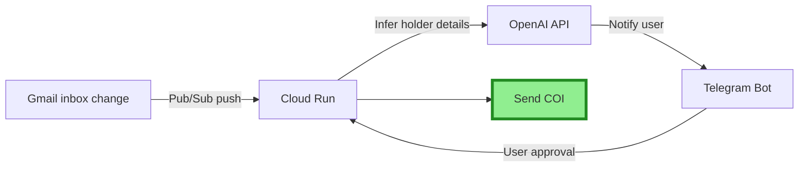

## Lion Insurance Services Automation

This project is about automation efforts for an Insurance Agency.

Currently it supports:
- Email monitoring for COI requests
- Automatically preparing and sending renewal documents to the clients
- Automatically setting up autopays at the beginning of each month

### COI Monitoring: How it works



### Declaration documents: how to run

`scripts/send_declaration_documents.py` drafts one "renewal documents" email per
client renewing in a given month. It finds dec pages in Gmail first and, for
GAIG / Paramount / Trinity lines (which never email them), logs into the
carrier's agent portal with Playwright and downloads them. Credentials for the
three portals live in `keys/*_credentials.json` (gitignored).

One-time setup (Playwright drives the system-installed Chrome, no browser download needed):

```bash
python -m venv venv
venv/Scripts/pip install -r requirements.txt
```

Run for a whole month (prompts for month and year):

```bash
PYTHONIOENCODING=utf-8 venv/Scripts/python scripts/send_declaration_documents.py
```

Re-run only specific clients (names as they appear in the Renewals doc), e.g. after
fixing something, without recreating everyone else's drafts:

```bash
PYTHONIOENCODING=utf-8 venv/Scripts/python scripts/send_declaration_documents.py --only "CLIENT A,CLIENT B"
```

Drafts land in Gmail under the `declaration-documents` label; the console output
is worth saving (`> scripts/run_<month>.log`) since it says per client what was
found where. `declarations.log` has the file log.
